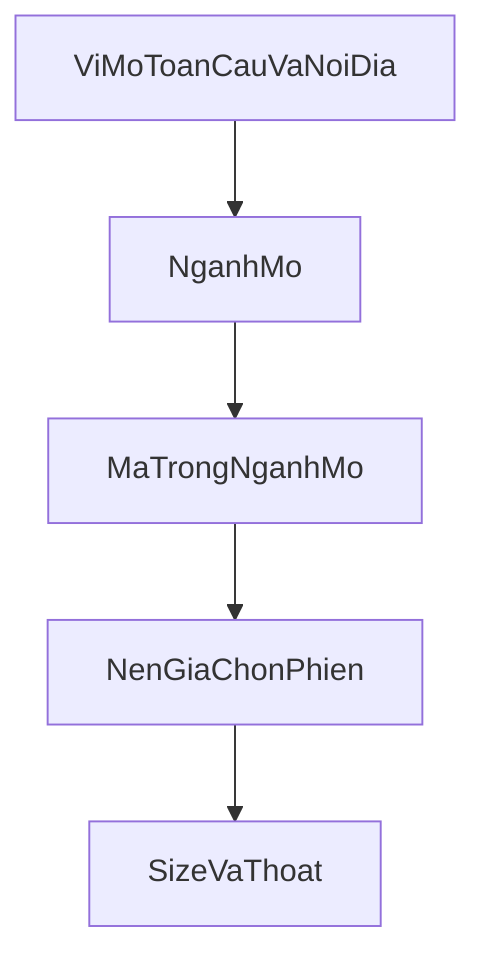

# Strategy ngành, mã, rồi thời điểm

Một đợt tăng hoặc một đợt giảm thường đi cả ngành. Từng mã trong ngành chỉ khác nhau ở mức tăng nhiều hay tăng ít. Vì vậy quyết định đi từ trên xuống: vĩ mô mở ngành nào, trong ngành đó mã nào đáng giữ, rồi mới chọn phiên vào, quy mô và cách thoát.

Điểm nền giá và cơ bản hiện tại trong [`research/app/evaluate.py`](research/app/evaluate.py) là tầng cuối. Nó chưa được phép một mình quyết định `Được vào`.

## Methodology

Mỗi tầng chỉ trả lời một câu. Tầng dưới không được sửa câu trả lời của tầng trên.

- Vĩ mô trả lời: môi trường này có đang cho phép một nhóm ngành tăng hay không. Cùng một số cho mọi mã trong ngày. Nó không chọn mã.
- Ngành trả lời: ngành nào đang trong sóng, so với VN-Index và so với chuỗi dẫn đã ấn định. Nó không chọn mã trong ngành, và không chọn phiên mua.
- Mã trả lời: trong ngành đang mở, tên nào có vị thế bền và giá còn rẻ so với chính nó và so với ngành. Danh sách này đổi chậm, theo quý và theo vốn hóa, không theo từng phiên.
- Thời điểm trả lời: trong danh sách đã khoanh, phiên nào nền giá cho phép mua. Nền giá không được kéo một mã ở ngành đang đóng vào sổ.
- Sổ trả lời: mua bao nhiêu và giữ bao lâu. Mục tiêu nắm trung bình khoảng 6 tháng, trong khoảng 3–12 tháng. Phí cả vòng 0,3% nhỏ so với một đợt tăng 20% nếu giữ được nửa năm.

Ba định nghĩa khóa trước khi đo, không chỉnh sau khi đã thấy kết quả:

- Một đợt tăng của một mã là cửa sổ 66 phiên liên tiếp, giá cuối cao hơn giá đầu ít nhất 20%, các cửa sổ của cùng một mã không chồng nhau. Giữ cách chọn tham lam theo mức tăng đã dùng khi đếm 123 đợt.
- Cửa sớm của đợt đó là các phiên từ ngày đầu cửa sổ cho đến trước phiên giá đóng cửa đã cao hơn giá đầu quá 15%. Muốn bắt đợt tăng thì tín hiệu phải rơi vào cửa này.
- Một ngành đang mở là một trạng thái theo ngày, tính từ lợi suất 60 phiên. Ngành đóng khi lợi suất đó không còn cao hơn VN-Index, hoặc chuỗi dẫn bắt buộc đang giảm. Chi tiết ở mục xác định ngành.

Luật cứng đã có vẫn đứng trước mọi tầng: giá chưa chỉnh chia tách, đình chỉ hoặc ngoại trừ kiểm toán, VN-Index dưới MA200, đăng ký bán của người nội bộ, và phá nền thất bại trong ba phiên. Chúng không bị điểm hay ngành ghi đè.

## Cách validate

Mọi tầng dùng cùng một phép đo. Chọn quy tắc trên các đợt có ngày bắt đầu từ 2024-04-16 đến 2025-12-31. Chỉ kết luận khi cùng quy tắc đó còn đúng với các đợt bắt đầu từ 2026-01-01 đến 2026-10-09. Không được nới ngưỡng sau khi xem năm 2026.

Với một quy tắc “mở” (ngành mở, hoặc mã được khoanh):

- Recall: số đợt tăng có ít nhất một phiên cửa sớm mà quy tắc đang mở, chia cho số đợt tăng.
- Precision: số phiên quy tắc mở mà 66 phiên sau đó tăng ít nhất 20%, chia cho số phiên quy tắc mở và còn đủ 66 phiên phía trước. Với cổng ngành, đơn vị là ngành-phiên. Với cổng mã, đơn vị là mã-phiên.
- Tỷ lệ nền: precision của quy tắc “luôn mở”. Quy tắc mới chỉ có ích khi precision của nó cao hơn tỷ lệ nền.
- Ngưỡng qua cửa, ấn định trước. Recall ít nhất 60% trên giai đoạn chọn và trên năm 2026. Precision ít nhất gấp đôi tỷ lệ nền trên cả hai giai đoạn. Thiếu một vế thì tầng đó chỉ được ghi vào verdict để theo dõi, chưa được chặn `Được vào`.

Lý do ngưỡng này: điểm 60 hiện bắt được khoảng 68% đợt tăng nhưng precision chỉ khoảng 16%, gần với việc mua rất nhiều phiên. Một cổng ngành mà đóng quá tay sẽ mất đợt tăng. Một cổng mà mở gần như luôn luôn thì không hơn cái điểm hiện tại.

Ngoài recall và precision, ghi thêm hai số để khỏi nhầm đơn vị:

- Số ngành mở trung bình mỗi phiên. Nếu gần bằng toàn bộ ngành có đủ mã, cổng không lọc.
- Trong các ngành mở, phân phối mức tăng 66 phiên của mã hạng cao và mã hạng thấp. Bước chọn mã chỉ qua cửa khi hạng cao có trung vị cao hơn hạng thấp trên cả hai giai đoạn.

LLM được chấm riêng, không trộn vào precision của cổng số. Mỗi nhận định tháng được so với các đợt tăng bắt đầu trong ba tháng sau đó. LLM chỉ được tham gia chọn ngành khi danh sách ngành nó nêu chứa đợt tăng thường hơn việc lấy mọi ngành đang mở theo cổng số.

Kết quả mỗi lần đo ghi thành một báo cáo trong `research/`, gồm số đợt, recall, precision, tỷ lệ nền, và giai đoạn. Không chỉnh định nghĩa đợt tăng giữa các báo cáo.

## Cách xác định ngành

Bảng ngành tĩnh cho đúng 51 mã trong `DEFAULT_UNIVERSE`, file mới [`research/app/industries.py`](research/app/industries.py). Ngân hàng, chứng khoán, bảo hiểm lấy từ `BANKS`, `SECURITIES`, `INSURERS` trong [`research/app/config.py`](research/app/config.py).

Nhóm đủ từ ba mã, mới được có lợi suất ngành và cổng ngành:

- Ngân hàng: 18 mã trong `BANKS`.
- Chứng khoán: 10 mã trong `SECURITIES`.
- Bảo hiểm: `BVH`, `BMI`, `BIC`, `MIG`, `PVI`.
- Bất động sản: `VIC`, `VHM`, `VRE`.
- Năng lượng: `GAS`, `PLX`, `PVS`.
- Tiêu dùng: `VNM`, `MWG`, `MSN`, `SAB`, `PNJ`.

Nhóm dưới ba mã chỉ có nhãn, không có cổng “mạnh hơn ngành”, vì lợi suất ngành trùng với chính mã đó. `HPG` và `DGC` là vật liệu. `VJC` và `GMD` là vận tải. `FPT` là công nghệ. `REE` là hạ tầng. `SBT` là nông nghiệp. Những mã này chỉ đi tiếp khi cổng vĩ mô trong nước đang mở, rồi bị xét như từng mã, không như một sóng ngành.

Lợi suất ngành một phiên là trung bình cộng phần trăm thay đổi giá của các mã cùng ngành có nến phiên đó. Thiếu một mã thì trung bình trên số mã còn lại. Lợi suất 60 phiên là giá trị tích lũy của chuỗi lợi suất ngày đó. Cùng cách tính cho VN-Index trên đúng các phiên đó.

Một ngành đủ mã được gọi là mở tại một phiên khi đủ các điều sau, tính chỉ với dữ liệu đến hết phiên hôm trước, để không dùng chính phiên đang xét:

- Lợi suất ngành 60 phiên kết thúc hôm qua cao hơn lợi suất VN-Index 60 phiên.
- Nếu ngành có chuỗi dẫn: lợi suất chuỗi dẫn 60 phiên kết thúc hôm qua dương. Năng lượng dùng giá dầu `CL=F`. Các ngành còn lại trong danh sách đủ mã không có chuỗi nước ngoài. Không thử chỉ số Hàn Quốc, Trung Quốc hay Mỹ cho ngân hàng, chứng khoán, bất động sản, tiêu dùng, bảo hiểm.
- Ngành nội địa cần thêm một xác nhận trong nước. Ngân hàng và chứng khoán: trung vị tăng trưởng dư nợ năm của các ngân hàng trong rổ, quý gần nhất đã qua 45 ngày, lớn hơn 0. Bất động sản, tiêu dùng, bảo hiểm: VN-Index hôm qua còn trên MA200. MA200 là điều kiện nền đã có trong [`market_regime`](research/app/pattern.py). Nó không thay cho việc ngành phải thắng chỉ số.

Chuỗi dẫn và điều kiện trong nước được ghi cứng trong `industries.py` trước lần đo đầu. Thêm một nước hoặc một độ trễ sau khi đã xem 123 đợt là đổi đề sau khi biết đáp án. Việc đó phải tính là một quy tắc mới và phải qua lại từ đầu trên giai đoạn 2024–2025 rồi mới được nhìn 2026.

Vĩ mô toàn cầu và trong nước được lưu để cổng này đọc lại được, không chỉ để trang live:

- [`fetch_macro`](research/app/ingest.py) đổi từ 6 tháng, chỉ giữ trong bộ nhớ, sang range dài và ghi vào `market_points`. Dầu và USD/VND lấy từ Yahoo.
- Lãi tái cấp vốn giữ bảng ghi tay trong config.
- Lãi qua đêm và lợi suất 10 năm không có lịch sử trên nguồn giá tức thời. Chưa điền số giả. Khi nào có nguồn lịch sử thì thêm như một xác nhận trong nước thứ hai, và đo lại từ đầu.
- Tín dụng là trung vị `CUSTOMER_LOANS_AQ_GRYOY` của các ngân hàng, cùng độ trễ báo cáo với điểm cơ bản.

LLM đọc cùng các số này vào ngày làm việc đầu tháng. Prompt không chứa giá các tháng sau, không chứa tên các đợt tăng, và không yêu cầu chọn mã. Đầu ra là danh sách ngành ưu tiên trong các ngành đủ mã, kèm một đoạn lý do. Lưu prompt và câu trả lời. Cổng số vẫn là cổng được phép chặn lệnh. LLM chỉ được nâng thành nguồn chọn ngành sau phép so ở mục validate.

Ví dụ cách đọc, không phải ngưỡng mới: giữa 2025, chứng khoán và bất động sản tăng cả nhóm. Cổng ngành phải mở chứng khoán vì lợi suất nhóm đó thắng VN-Index, rồi mới xét `SSI`, `VND`, `SHS`. Nó không cần `SHS` là công ty lớn nhất ngành thì ngành mới được gọi là mở.

## Cách chọn cổ phiếu trong ngành

Chỉ xét mã thuộc ngành đang mở. Ngành đóng thì mã đó không vào danh sách khoanh, dù nền giá có đẹp. Mã thuộc ngành một tên thì không dùng bước này. Nó chỉ còn cổng vĩ mô và, sau này, nền giá.

Trong ngành đang mở, mỗi mã có bốn số, tính đến hết phiên hôm trước:

- Hạng vốn hóa: vốn hóa bằng số cổ phiếu lưu hành gần nhất đã biết nhân giá đóng cửa. Hạng 1 là lớn nhất ngành.
- Hạng doanh thu: doanh thu quý gần nhất đã qua 45 ngày, với ngân hàng thì thay bằng dư nợ. Hạng 1 là lớn nhất ngành.
- Rẻ so với chính mình: P/E trượt chia cho trung vị P/E trượt của mã đó trong ba năm liền trước. P/E trượt là vốn hóa chia tổng lợi nhuận bốn quý đã công bố. Nhỏ hơn 1 là rẻ hơn quá khứ của chính nó.
- Rẻ so với ngành: P/E trượt chia cho trung vị P/E trượt của các mã cùng ngành trong ngày. Nhỏ hơn 1 là rẻ hơn ngành.

P/E âm hoặc lợi nhuận bốn quý không dương thì không có mức rẻ. Mã đó vẫn có hạng vị thế, nhưng không được điểm rẻ.

“Mạnh” ở bước này là vị thế, không phải lợi nhuận quý đang tăng. Hạng vốn hóa và hạng doanh thu là thước vị thế đo được. Bảng cân đối đã có trong điểm cơ bản, gồm nợ, dòng tiền, nợ xấu và bao phủ với ngân hàng, chỉ dùng như một cờ loại: mã đang vi phạm trần nợ, nợ xấu hoặc pha loãng có hại thì rời danh sách khoanh. Không cộng điểm vì lợi nhuận năm nay cao hơn năm trước. Đo thêm một chuỗi ứng viên là hiệu tăng trưởng lợi nhuận quý này trừ quý trước. Chỉ giữ chuỗi đó nếu trên giai đoạn chọn, trong cùng ngành mở, nhóm tăng tốc có trung vị lợi nhuận 66 phiên cao hơn nhóm không tăng tốc, và năm 2026 còn cùng chiều.

Danh sách khoanh của một ngành mở lấy theo thứ tự:

- Bỏ mã vi phạm cờ bảng cân đối.
- Giữ nửa trên theo vị thế. Vị thế là hạng tốt hơn giữa hạng vốn hóa và hạng doanh thu, để một mã lớn về doanh thu nhưng vốn hóa chưa theo kịp không bị loại chỉ vì giá đang thấp.
- Trong nửa đó, xếp theo độ rẻ so với ngành, rồi độ rẻ so với chính mình. Thiếu P/E thì xếp sau các mã có P/E.
- Mỗi ngành mở giữ tối đa ba mã. Cả sổ vẫn tối đa năm suất trong [`MAX_SLOTS`](research/app/config.py). Nếu nhiều ngành cùng mở, lấy mã có độ rẻ so với ngành tốt nhất cho đến khi đủ năm suất.

Phép đo của riêng bước này, chỉ trên các mã thuộc ngành mở:

- Recall mã: trong các đợt tăng của ngành đó, bao nhiêu đợt có mã nằm trong danh sách khoanh ngay tại cửa sớm.
- Tách hạng: trung vị lợi nhuận 66 phiên của các mã được khoanh trừ trung vị của các mã cùng ngành mở nhưng không được khoanh.
- Qua cửa khi recall mã ít nhất 50% trên cả hai giai đoạn, và trung vị nhóm được khoanh cao hơn nhóm bị loại trên cả hai giai đoạn. Ngưỡng 50% thấp hơn recall ngành vì trong một sóng, một phần mã tăng ít vẫn là đúng cấu trúc “tăng cả ngành, nhiều ít tùy mã”. Bước này có nhiệm vụ nghiêng về mã tăng nhiều, không có nhiệm vụ bắt mọi mã trong ngành.

`SHS` là case để soi sau khi đo, không phải để nới quy tắc. Nếu sóng chứng khoán mở mà hạng vị thế loại `SHS` và vì thế mất đợt tăng lớn, báo cáo phải ghi số đó. Nếu mất nhiều đợt tương tự đến mức không qua cửa, bước vị thế không được chặn. Khi đó danh sách khoanh trong ngành mở xếp theo độ rẻ, không cắt theo hạng.

## Thời điểm, quy mô, thoát

Chỉ triển khai sau khi cổng ngành đã qua cửa và đang được phép chặn. Nền giá hiện tại chỉ chạy trên danh sách đã khoanh. Một mã ngành đóng không thành ứng viên trong [`_candidates`](research/app/backtest.py).

Quy mô giữ nguyên: rủi ro 1% vốn mỗi lệnh, trần 35% một mã, tối đa năm suất.

Thoát hiện tại không theo khoảng nắm 3–12 tháng. [`TIME_STOP_SESSIONS`](research/app/config.py) là 30 và [`MAX_HOLD_SESSIONS`](research/app/config.py) là 60, và một phần vị thế chốt tại +1R. Khi tới bước này, trần nắm đưa lên 132 phiên, khoảng 6 tháng. Cắt sớm chỉ còn phá nền thất bại trong ba phiên đầu, đúng luật đang có. Chưa sửa các hằng số này ở các phase trước.

## Dữ liệu cần có trước lần đo đầu

- Dòng ngoại: [`fetch_foreign_flow`](research/app/ingest.py) hết phân trang VNDirect, [`replace_flow`](research/app/db.py) đổi thành upsert. Mỗi mã phải phủ cửa sổ 2024-04-16 đến 2026-10-09. Dòng ngoại chưa tham gia cổng ngành. Nó là chuỗi ứng viên của bước chọn mã, đo cùng cách với tăng tốc lợi nhuận.
- P/E và vốn hóa tính từ nến, số cổ phiếu và lợi nhuận quý đã lưu. Ghi chuỗi theo ngày.
- Lợi suất ngành tính lúc đo, không cần bảng giá mới.
- Dầu, USD/VND và các chuỗi Yahoo khác được lưu vào `market_points`.

## Cách giao

Nhánh làm việc tách từ `origin/main`. Nhánh `research-failed-breakout-exit` không dùng tiếp. `compose` ở phase ngành và phase mã chỉ thêm trường trạng thái vào verdict. `Được vào` đổi lần đầu khi cổng ngành qua năm 2026. Phase chọn mã đổi danh sách ứng viên lần thứ hai khi chính nó qua cửa. Phase thoát là lần đổi cuối.

Mỗi phase có test đơn vị cho công thức lợi suất, P/E, hạng và độ trễ một phiên, cộng một báo cáo recall và precision trên hai giai đoạn.
